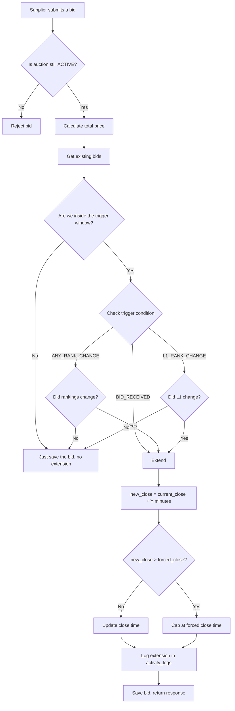

# High-Level Design: British Auction in RFQ System

## Overview

This is a procurement platform where buyers publish RFQs (Request for Quotation) and suppliers compete by submitting price quotes. The twist is that the system uses a British Auction mechanism to prevent last-second bid sniping — if competitive bidding activity happens close to the deadline, the auction automatically extends.

The key constraint is that the auction can never extend past a hard cap called Forced Bid Close Time. This prevents auctions from running forever.

## Architecture

```
+------------------------------------------+
|            React Frontend                |
|  Buyer dashboard, Supplier portal,      |
|  countdown timer, activity log           |
+------------------------------------------+
              ↕  REST API (HTTP)
+------------------------------------------+
|           FastAPI Backend                |
|  CRUD endpoints, bid processing,         |
|  auction extension engine                |
+------------------------------------------+
              ↕  SQLAlchemy ORM
+------------------------------------------+
|         PostgreSQL / SQLite              |
|  Tables: rfqs, bids, activity_logs       |
+------------------------------------------+
```

The frontend talks to the backend via REST APIs. There's no authentication layer right now — the buyer/supplier distinction is handled via a view toggle on the frontend side. The backend handles all the auction logic including checking trigger windows and deciding whether to extend.

## How the Extension Logic Works

When a supplier submits a bid, the backend runs through this flow:



The trigger window check is straightforward:
```
window_start = bid_close_time - X_minutes
is_in_window = window_start <= now <= bid_close_time
```

And the hard cap is enforced with:
```
new_close = min(proposed_close, forced_bid_close_time)
```

## API Endpoints

| Method | Endpoint | What it does |
|--------|----------|--------------|
| GET | `/api/rfqs` | List all RFQs with current status and lowest bid |
| POST | `/api/rfqs` | Create a new RFQ with auction config |
| GET | `/api/rfqs/{id}` | Get full RFQ details — bids (ranked), activity logs, config |
| POST | `/api/rfqs/{id}/bids` | Submit a supplier quote, triggers extension check |
| GET | `/api/health` | Health check |

## Frontend Approach

Kept it simple with just `useState` and `useEffect`. No Redux or routing library.

- The detail page polls `GET /api/rfqs/{id}` every 3 seconds to stay in sync.
- The countdown timer ticks every second using `setInterval`.
- Buyer vs Supplier view is just a state variable (`currentView`) that controls which buttons are visible.

## Database Design

Three tables with straightforward relationships:
- **rfqs** — stores the auction config (X minutes, Y minutes, trigger rule, close times)
- **bids** — each quote submitted by a supplier, linked to an RFQ
- **activity_logs** — audit trail of everything that happened (bids placed, extensions granted, reasons why)

One RFQ has many bids, one RFQ has many activity logs. Both use cascade delete.

Full schema details and ER diagram are in `SCHEMA_DESIGN.md`.

## What I'd Improve With More Time

- Add WebSocket support instead of polling for real-time updates
- Add proper user authentication (JWT) so buyers and suppliers have actual accounts
- Use Redis for handling concurrent bid submissions and preventing race conditions
- Deploy with Docker for easier setup
