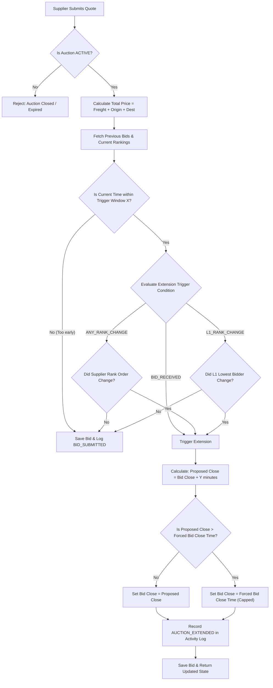

# High-Level Design (HLD): British Auction in RFQ System

## 1. Executive Summary
This document outlines the architecture and design of the **British Auction RFQ (Request for Quotation) System**. The platform enables buyers to initiate competitive procurement events and suppliers to submit transparent, iterative quotations. 

To eliminate last-second bidding manipulation (bid sniping), the system employs **British Auction dynamic extensions**: whenever qualifying bidding activity happens within a configurable **Trigger Window (X minutes)** before closing, the auction deadline is automatically extended by **Extension Duration (Y minutes)**, while strictly honoring an unbreachable **Forced Bid Close Time** hard cap.

---

## 2. Architecture Diagram

```
+-------------------------------------------------------+
|                     React Frontend                    |
|  - Buyer Dashboard (RFQ Creation & Config)           |
|  - Supplier Portal (Quote Submission & Rankings)      |
|  - Real-time Countdown & Audit Activity Log           |
+-------------------------------------------------------+
                           ↕ (HTTP / REST APIs)
+-------------------------------------------------------+
|                    FastAPI Backend                    |
|  - REST Endpoints (/rfqs, /bids, /health)             |
|  - Pydantic Input Validation & Sanitization           |
|  - British Auction Engine:                            |
|      * Window detection [Close - X min, Close]       |
|      * Extension trigger evaluation                   |
|      * Hard cap enforcement (Forced Close Time)       |
+-------------------------------------------------------+
                           ↕ (SQLAlchemy ORM)
+-------------------------------------------------------+
|                  PostgreSQL Database                  |
|  - Tables: rfqs, bids, activity_logs                  |
|  - Automatic local SQLite fallback for dev            |
+-------------------------------------------------------+
```

---

## 3. Core Components

### 3.1. Frontend (React + Vite)
* Built with modern React using clean hooks (`useState`, `useEffect`).
* **Auto-Sync Mechanism:** Polls the active RFQ endpoints every 3 seconds while on the auction detail view. This guarantees that buyers and competing suppliers see updated L1 rankings, bids, and time extensions live without needing complex external brokers.
* **Buyer Dashboard:** Intuitive form to define RFQ details, scheduled close times, forced close limits, and British Auction parameters (X, Y, trigger condition).
* **Supplier Dashboard:** Real-time quote submission modal with price breakdown (Freight + Origin + Destination charges) and live countdown timer.
* **Audit Activity Timeline:** Chronological log displaying every bid placed, every time extension granted with its exact reason, and hard cap notifications.

### 3.2. Backend (FastAPI + Python 3.11)
* **REST APIs:** Structured endpoints for RFQ lifecycle management and bid processing.
* **Pydantic Schemas:** Strong validation ensuring:
  1. `Forced Bid Close Time > Bid Close Time`
  2. `Bid Close Time > Bid Start Time`
  3. Positive freight and charge inputs.
* **Auction Engine (`auction_engine.py`):**
  - Isolates business rules for anti-sniping and deadline extensions.
  - Computes dynamic status (`ACTIVE`, `CLOSED`, `FORCE_CLOSED`, `UPCOMING`).

### 3.3. Database Layer (SQLAlchemy + PostgreSQL)
* Relational schema connecting RFQs to multiple supplier quotes and persistent audit logs.
* Database session dependency injection (`get_db`) with connection cleanup.
* Environment-driven configuration via `.env` with graceful local SQLite fallback for zero-friction setup.

---

## 4. British Auction Logic & Extension Workflow

When a supplier submits a quotation for an active RFQ:



### Supported Extension Rules:
1. **Rule A (`BID_RECEIVED`):** Any bid submitted in the last X minutes triggers an extension of Y minutes.
2. **Rule B (`ANY_RANK_CHANGE`):** If any supplier moves up or down in the overall ranking during the trigger window, the auction extends.
3. **Rule C (`L1_RANK_CHANGE`):** The auction extends **only** when the lowest quotation (L1) is beaten by another supplier.

---

## 5. Anti-Sniping & Forced Close Hard Cap
* **The Problem:** In open auctions, suppliers often place bids in the last 10 seconds to prevent others from reacting ("sniping").
* **British Auction Solution:** Extends the deadline by Y minutes whenever qualifying competitive activity occurs inside window X.
* **The Risk:** Unlimited extensions could cause auctions to run indefinitely.
* **The Invariant:** `new_close = min(current_close + Y, forced_bid_close_time)`. Under no circumstances can any bid or extension push the auction deadline beyond the Forced Close Time. Once the hard cap is reached, no further extensions are granted.

---

## 6. Scalability & Future Enhancements
* **WebSockets:** Can replace client-side polling with push notifications via FastAPI's native WebSocket support.
* **Redis / Celery:** For high-traffic auctions with thousands of concurrent suppliers, Redis can be used for distributed locking (preventing race conditions during simultaneous bids) and Celery for async notification emails.
