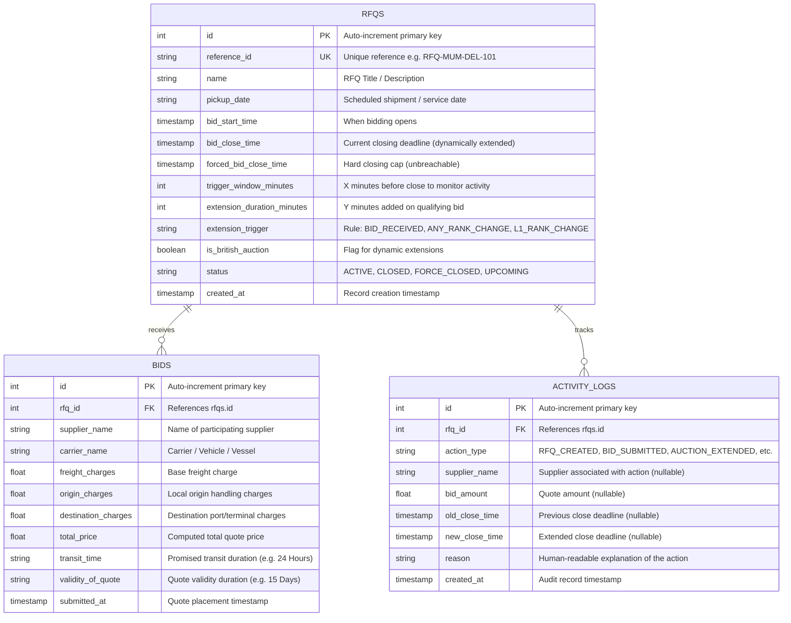

# Database Schema Design: British Auction RFQ System

## 1. Entity Relationship (ER) Diagram

---

## 2. Table Specifications

### 2.1. Table: `rfqs`
Stores the RFQ master configuration, bidding schedule, and anti-sniping extension parameters.

| Column Name | Data Type | Constraints | Description |
|---|---|---|---|
| `id` | `INTEGER` | Primary Key, Auto-increment | Internal unique identifier |
| `reference_id` | `VARCHAR(100)` | Unique, Indexed, Not Null | Business reference ID (e.g. `RFQ-2026-001`) |
| `name` | `VARCHAR(255)` | Not Null | RFQ title / service scope |
| `pickup_date` | `VARCHAR(50)` | Not Null | Service or cargo pickup date |
| `bid_start_time` | `TIMESTAMP` | Not Null | Auction start timestamp (UTC) |
| `bid_close_time` | `TIMESTAMP` | Not Null | Dynamic closing deadline, updated on extension |
| `forced_bid_close_time` | `TIMESTAMP` | Not Null | Hard cap; close time can never exceed this |
| `trigger_window_minutes` | `INTEGER` | Not Null, Default `10` | Parameter X: activity window before close |
| `extension_duration_minutes` | `INTEGER` | Not Null, Default `5` | Parameter Y: extra minutes granted on trigger |
| `extension_trigger` | `VARCHAR(50)` | Not Null, Default `'BID_RECEIVED'` | Rule: `BID_RECEIVED`, `ANY_RANK_CHANGE`, `L1_RANK_CHANGE` |
| `is_british_auction` | `BOOLEAN` | Not Null, Default `TRUE` | Enables or disables British Auction extension behavior |
| `status` | `VARCHAR(30)` | Not Null, Default `'ACTIVE'` | Auction state (`ACTIVE`, `CLOSED`, `FORCE_CLOSED`, `UPCOMING`) |
| `created_at` | `TIMESTAMP` | Not Null, Default `UTC_NOW` | Timestamp when RFQ was created |

### 2.2. Table: `bids`
Stores all submitted supplier quotes.

| Column Name | Data Type | Constraints | Description |
|---|---|---|---|
| `id` | `INTEGER` | Primary Key, Auto-increment | Unique quote identifier |
| `rfq_id` | `INTEGER` | Foreign Key (`rfqs.id` ON DELETE CASCADE), Not Null | Associated RFQ |
| `supplier_name` | `VARCHAR(150)` | Not Null | Name of bidding vendor |
| `carrier_name` | `VARCHAR(150)` | Not Null | Carrier or transport partner |
| `freight_charges` | `NUMERIC(12,2)` | Not Null, Check `>= 0` | Base freight cost |
| `origin_charges` | `NUMERIC(12,2)` | Not Null, Default `0.0` | Origin handling / documentation charges |
| `destination_charges` | `NUMERIC(12,2)` | Not Null, Default `0.0` | Destination delivery / terminal charges |
| `total_price` | `NUMERIC(12,2)` | Not Null | Calculated total: `freight + origin + destination` |
| `transit_time` | `VARCHAR(50)` | Not Null | Promised delivery timeframe |
| `validity_of_quote` | `VARCHAR(50)` | Not Null | Expiration period of the submitted quote |
| `submitted_at` | `TIMESTAMP` | Not Null, Default `UTC_NOW` | Submission timestamp |

### 2.3. Table: `activity_logs`
Provides an immutable audit trail of bids, rankings, and anti-sniping deadline extensions.

| Column Name | Data Type | Constraints | Description |
|---|---|---|---|
| `id` | `INTEGER` | Primary Key, Auto-increment | Log identifier |
| `rfq_id` | `INTEGER` | Foreign Key (`rfqs.id` ON DELETE CASCADE), Not Null | Associated RFQ |
| `action_type` | `VARCHAR(50)` | Not Null | `RFQ_CREATED`, `BID_SUBMITTED`, `AUCTION_EXTENDED`, `EXTENSION_CAPPED`, `AUCTION_CLOSED` |
| `supplier_name` | `VARCHAR(150)` | Nullable | Supplier associated with the event |
| `bid_amount` | `NUMERIC(12,2)` | Nullable | Price associated with the bid event |
| `old_close_time` | `TIMESTAMP` | Nullable | Previous close time before extension |
| `new_close_time` | `TIMESTAMP` | Nullable | New close time after extension |
| `reason` | `TEXT` | Not Null | Clear justification for the extension or event |
| `created_at` | `TIMESTAMP` | Not Null, Default `UTC_NOW` | Timestamp of the event |

---

## 3. Database Indexes & Optimization
1. `rfqs(reference_id)`: Unique B-tree index for rapid lookups and duplicate prevention.
2. `bids(rfq_id, total_price ASC)`: Composite index to rapidly retrieve and sort rankings (L1, L2, L3) with minimal I/O overhead.
3. `activity_logs(rfq_id, created_at DESC)`: Index for displaying the audit timeline in reverse chronological order.
