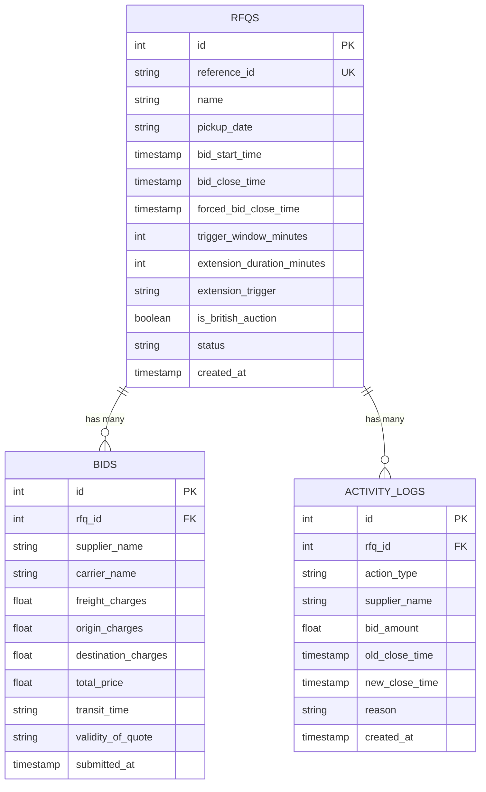

# Database Schema Design

## ER Diagram

## Table Details

### rfqs

Main table that stores each auction along with its British Auction configuration.

| Column | Type | Notes |
|--------|------|-------|
| id | INTEGER | Primary key, auto-increment |
| reference_id | VARCHAR | Unique business ID like `RFQ-MUM-DEL-101` |
| name | VARCHAR | Title describing the shipment |
| pickup_date | VARCHAR | When the goods need to be picked up |
| bid_start_time | TIMESTAMP | When suppliers can start bidding |
| bid_close_time | TIMESTAMP | Current closing deadline (this gets extended dynamically) |
| forced_bid_close_time | TIMESTAMP | Absolute hard cap — close time can never go past this |
| trigger_window_minutes | INTEGER | X — how many minutes before close to watch for activity |
| extension_duration_minutes | INTEGER | Y — how many minutes to add when triggered |
| extension_trigger | VARCHAR | One of: `BID_RECEIVED`, `ANY_RANK_CHANGE`, `L1_RANK_CHANGE` |
| is_british_auction | BOOLEAN | Whether the extension mechanism is enabled |
| status | VARCHAR | `ACTIVE`, `CLOSED`, `FORCE_CLOSED`, or `UPCOMING` |
| created_at | TIMESTAMP | When this RFQ was created |

### bids

Each row is a supplier's submitted quote for an RFQ. Multiple suppliers can bid on the same RFQ, and the same supplier can bid multiple times (to lower their price).

| Column | Type | Notes |
|--------|------|-------|
| id | INTEGER | Primary key |
| rfq_id | INTEGER | FK to rfqs.id (cascade delete) |
| supplier_name | VARCHAR | Company name |
| carrier_name | VARCHAR | Vehicle/vessel used |
| freight_charges | FLOAT | Base freight cost |
| origin_charges | FLOAT | Charges at pickup location |
| destination_charges | FLOAT | Charges at delivery location |
| total_price | FLOAT | Sum of above three (calculated on submit) |
| transit_time | VARCHAR | e.g. "24 Hours", "3 Days" |
| validity_of_quote | VARCHAR | How long the quote is valid |
| submitted_at | TIMESTAMP | When the bid was placed |

### activity_logs

Audit trail for everything that happens in an auction. Used to show the timeline on the frontend and to explain why each extension happened.

| Column | Type | Notes |
|--------|------|-------|
| id | INTEGER | Primary key |
| rfq_id | INTEGER | FK to rfqs.id (cascade delete) |
| action_type | VARCHAR | `RFQ_CREATED`, `BID_SUBMITTED`, `AUCTION_EXTENDED`, etc. |
| supplier_name | VARCHAR | Which supplier triggered this event (nullable) |
| bid_amount | FLOAT | The bid amount involved (nullable) |
| old_close_time | TIMESTAMP | Previous close time before extension (nullable) |
| new_close_time | TIMESTAMP | New close time after extension (nullable) |
| reason | TEXT | Human-readable explanation |
| created_at | TIMESTAMP | When this event occurred |

## Indexes

- `rfqs(reference_id)` — unique index for fast lookup and preventing duplicates
- `bids(rfq_id, total_price)` — for quickly fetching ranked bids per RFQ
- `activity_logs(rfq_id, created_at)` — for displaying the timeline in order
